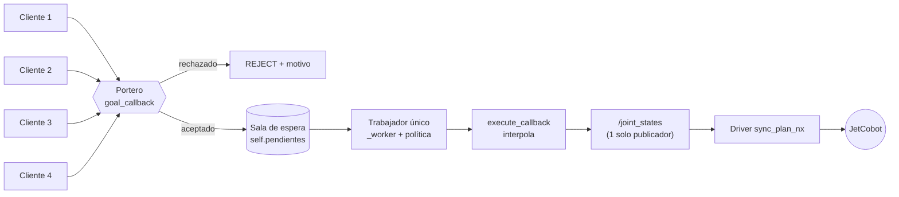
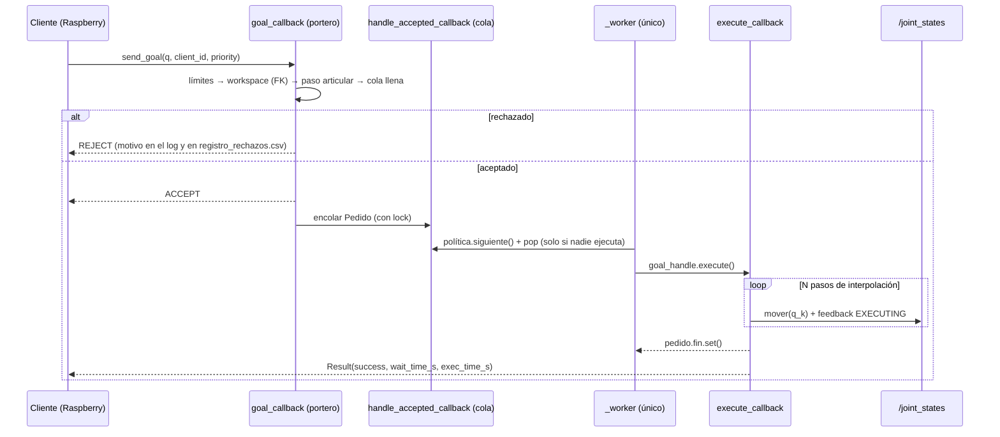

# Tutorial del Ítem 2 — `arm_broker`: el policía de tránsito del JetCobot

**Universidad ESAN · Robótica (08079) · Reto del Brazo 2 (RB-2)**

Este tutorial explica, línea por línea y con el *porqué* de cada decisión, cómo se construye el broker
del ítem 2. El código que ves aquí **no está escrito aparte**: se extrae automáticamente de los archivos
del repositorio (`src/arm_broker/...`), así que lo que lees es exactamente lo que se compila.

> **Autoría.** La estructura base (manifiestos, `setup.py`, `CMakeLists.txt`, interfaces, nodo `cliente`,
> publicador de `/arm/queue_state`) la entrega el curso. Lo que se califica del ítem 2 es lo que va en los
> bloques `IMPLEMENTAR`: `goal_callback`, `handle_accepted_callback`, `_worker`, `execute_callback`, las
> políticas de `politicas.py` y la FK de `fk.py`. Decláralo en tu README.

## Índice

0. [El problema y la solución en un minuto](#0-el-problema-y-la-solución-en-un-minuto)
1. [Interfaces: `arm_broker_interfaces`](#1-interfaces-arm_broker_interfaces)
2. [El portero: control de admisión (`goal_callback`)](#2-el-portero-control-de-admisión-goal_callback)
3. [La sala de espera: encolar (`handle_accepted_callback`)](#3-la-sala-de-espera-encolar-handle_accepted_callback)
4. [El trabajador único: ejecución serie (`_worker` y `execute_callback`)](#4-el-trabajador-único-ejecución-serie-_worker-y-execute_callback)
5. [Políticas de cola: FIFO y prioridad con envejecimiento](#5-políticas-de-cola-fifo-y-prioridad-con-envejecimiento)
6. [Lista de entregables para el profesor](#6-lista-de-entregables-para-el-profesor)
7. [Preguntas típicas de la sustentación](#7-preguntas-típicas-de-la-sustentación)

---

## 0. El problema y la solución en un minuto

Cuatro integrantes (cuatro Raspberry Pi) mandan movimientos al **mismo** brazo. Si los cuatro publicaran
directo en `/joint_states`, el brazo no daría error: obedecería mensajes **intercalados** de distintos
clientes y se movería a poses que nadie pidió. Es un **fallo silencioso**, el peor tipo.

La solución es un único nodo, `arm_broker`, que se comporta como un consultorio con un solo médico:

| Rol | Dónde vive | Qué hace | Regla |
|---|---|---|---|
| **Portero** | `goal_callback` | Mira cada pedido en un instante y lo acepta o lo rechaza **con motivo** | Barato e inmediato. Nunca mueve el brazo |
| **Sala de espera** | `handle_accepted_callback` + `self.pendientes` | Anota a los aceptados | Solo encola. No ejecuta ni publica |
| **Médico único** | `_worker` + `execute_callback` | Un hilo elige al siguiente según la política y lo atiende hasta el final | Hasta que no termina, no llama a otro |

**Regla de oro: ningún cliente publica en `/joint_states`.** Los clientes solo envían *goals* a la acción
`move_arm`. El único punto del programa que publica en `/joint_states` es `ArmBroker.mover()`, y solo se
le llama desde `execute_callback`.



**Qué puntos de la rúbrica toca este ítem:** *Broker: exclusión mutua y encolado correcto* (5 pts) y
*Admisión validada con FK y rechazos razonados* (3 pts). Además, la exclusión mutua es un requisito
**eliminatorio**: cualquier cliente que publique directo en `/joint_states` anula esos 5 puntos.

---

## 1. Interfaces: `arm_broker_interfaces`

Las interfaces son el **contrato** entre los clientes y el broker: qué se puede pedir, qué se responde y
qué se informa mientras tanto. Van en su propio paquete (`ament_cmake`) porque ROS 2 genera código Python
y C++ a partir de ellas, y eso solo lo hace CMake.

```
src/arm_broker_interfaces/
├── CMakeLists.txt
├── package.xml
├── action/MoveArm.action
└── msg/QueueState.msg
```

### 1.1 `action/MoveArm.action`

```text
# src/arm_broker_interfaces/action/MoveArm.action
# Pedido de movimiento al arm_broker.
# priority: 0..255, MAYOR número = MÁS urgente.
float64[] joint_positions   # destino: 6 ángulos articulares en radianes
string client_id            # quién pide (sirve para la equidad de Jain)
uint8 priority
---
bool success
string message              # qué pasó, en texto legible
float64 wait_time_s         # cuánto esperó en la cola
float64 exec_time_s         # cuánto tardó el movimiento
---
string state                # QUEUED | EXECUTING
int32 queue_position        # lugar en la cola (0 = ya se ejecuta)
float64 elapsed_s
```

Una acción tiene **tres bloques** separados por `---`: *goal* (lo que se pide), *result* (cómo terminó) y
*feedback* (lo que se informa mientras corre).

| Campo | Bloque | Por qué existe |
|---|---|---|
| `joint_positions` | goal | El destino: 6 ángulos en **radianes**. Es lo que la FK valida |
| `client_id` | goal | Quién pide. Sin él no se puede calcular la equidad de Jain ni saber a quién pertenece cada espera |
| `priority` | goal | Urgencia 0–255 (`uint8` impone el rango). **Mayor número = más urgente** |
| `success`, `message` | result | Si terminó bien y, si no, por qué, en texto legible |
| `wait_time_s` | result | Cuánto esperó en la cola. Es la métrica central del ítem 3 |
| `exec_time_s` | result | Cuánto tardó el movimiento. Separar espera de ejecución evita mezclar causas |
| `state`, `queue_position`, `elapsed_s` | feedback | `QUEUED` o `EXECUTING`, y el lugar en la cola |

### 1.2 `msg/QueueState.msg` (se publica a 5 Hz en `/arm/queue_state`)

```text
# src/arm_broker_interfaces/msg/QueueState.msg
# Estado de la cola, publicado a 5 Hz en /arm/queue_state.
# Los arreglos queued_* son PARALELOS: el índice i de cada uno describe el mismo pedido.
builtin_interfaces/Time stamp
string executing_client
string executing_goal_id    # un único id por instante = exclusión mutua cumplida
float64 executing_elapsed_s
int32 queue_length
string[] queued_goal_ids
string[] queued_clients
uint8[] queued_priorities
float64[] queued_wait_s
int32 total_accepted
int32 total_rejected
int32 total_completed
```

Los cuatro arreglos `queued_*` son **paralelos**: el elemento *i* de cada uno describe el mismo pedido.
`metricas.py` los recorre con `zip(...)`, así que el broker siempre debe llenarlos con la misma longitud.
`executing_goal_id` es la clave de la prueba de exclusión mutua (sección 6.3): en cada mensaje hay **un
único** id ejecutándose.

### 1.3 `CMakeLists.txt`

```cmake
# src/arm_broker_interfaces/CMakeLists.txt
cmake_minimum_required(VERSION 3.8)
project(arm_broker_interfaces)

find_package(ament_cmake REQUIRED)
find_package(rosidl_default_generators REQUIRED)
find_package(action_msgs REQUIRED)
find_package(builtin_interfaces REQUIRED)

# Genera el código Python/C++ de la acción y del mensaje
rosidl_generate_interfaces(${PROJECT_NAME}
  "action/MoveArm.action"
  "msg/QueueState.msg"
  DEPENDENCIES action_msgs builtin_interfaces
)

ament_export_dependencies(rosidl_default_runtime)
ament_package()
```

- `rosidl_generate_interfaces(...)` convierte los `.action` y `.msg` en código Python y C++.
- `action_msgs` es necesario porque toda acción incluye mensajes de estado del goal.
- `builtin_interfaces` aporta el tipo `Time` que usa `stamp`.
- `rosidl_default_generators` (en `find_package`) es el paquete que contiene los generadores.

### 1.4 `package.xml`

```xml
# src/arm_broker_interfaces/package.xml
<?xml version="1.0"?>
<package format="3">
  <name>arm_broker_interfaces</name>
  <version>0.1.0</version>
  <description>Interfaces del broker de acceso al JetCobot</description>
  <maintainer email="equipo@esan.edu.pe">equipo</maintainer>
  <license>Apache-2.0</license>

  <buildtool_depend>ament_cmake</buildtool_depend>
  <buildtool_depend>rosidl_default_generators</buildtool_depend>

  <depend>action_msgs</depend>
  <depend>builtin_interfaces</depend>

  <exec_depend>rosidl_default_runtime</exec_depend>
  <member_of_group>rosidl_interface_packages</member_of_group>

  <export>
    <build_type>ament_cmake</build_type>
  </export>
</package>
```

- `buildtool_depend` en `rosidl_default_generators`: se necesita **al compilar**.
- `exec_depend` en `rosidl_default_runtime`: se necesita **al ejecutar**.
- `member_of_group` en `rosidl_interface_packages`: le dice a ROS 2 que este paquete define interfaces.
  Sin esta línea, `ros2 interface show` no lo encuentra.

El paquete Python `arm_broker` declara `<depend>arm_broker_interfaces</depend>`, y por eso `colcon` compila
primero las interfaces. También necesita `resource/arm_broker` (archivo **vacío**) y `arm_broker/__init__.py`:
sin ellos, `colcon build` falla.

### 1.5 Compilar y comprobar

```bash
mkdir -p ~/rb2_ws/src && cp -r src/* ~/rb2_ws/src/
cd ~/rb2_ws && colcon build
source install/setup.bash

ros2 interface show arm_broker_interfaces/action/MoveArm
ros2 interface show arm_broker_interfaces/msg/QueueState
```

| Síntoma | Causa probable |
|---|---|
| `colcon build` pide `rosidl_default_generators` | `sudo apt install -y ros-humble-rosidl-default-generators` |
| `ros2 interface show` no encuentra el paquete | Falta `source install/setup.bash` en esa terminal, o falta `member_of_group` |
| Errores de tipo en `exportar_csv.py` o `metricas.py` | Mezclaste versiones del `.msg` (`int32` frente a `uint32`). Usa solo la de este repositorio |

---

## 2. El portero: control de admisión (`goal_callback`)

### 2.1 Qué debe hacer y qué no

`goal_callback` se ejecuta **mientras el cliente espera la respuesta** a su `send_goal`. Por eso debe ser
**barato e inmediato**: aritmética de matrices 4×4 y comparaciones, nada más. Y tiene una prohibición
absoluta: **nunca mueve el brazo**. Solo contesta `ACCEPT` o `REJECT`.

Los filtros van del más barato al más caro, y cada rechazo lleva un **motivo explícito con los números
que lo causaron**. La rúbrica lo pide: "todo rechazo indica causa: workspace, límite o paso excesivo".

| Orden | Filtro | Función | Qué compara |
|---|---|---|---|
| 1 | Límites articulares | `fk.dentro_de_limites` | Cada ángulo contra su rango físico (no necesita FK) |
| 2 | Workspace | `fk.dentro_del_workspace` | Con la FK calcula la posición del efector: distancia a la base y `z ≥ 0` |
| 3 | Paso articular | `fk.paso_articular` | El mayor salto de una articulación desde la pose actual |
| 4 | Cola | `len(self.pendientes)` | Que haya sitio en la sala de espera |

### 2.2 Las funciones matemáticas de `fk.py`

Las tres devuelven `(ok, motivo)`: el motivo se **construye donde se detecta el problema**, que es donde se
conocen los números.

```python
# src/arm_broker/arm_broker/fk.py  →  dentro_de_limites
def dentro_de_limites(q):
    if len(q) != 6:
        return False, f'se esperaban 6 ángulos, llegaron {len(q)}'
    for i, (valor, (lo, hi)) in enumerate(zip(q, JOINT_LIMITS)):
        if not lo <= valor <= hi:
            return False, f'{JOINT_NAMES[i]} fuera de rango: {valor:.3f} rad, límite [{lo}, {hi}]'
    return True, ''
```

```python
# src/arm_broker/arm_broker/fk.py  →  dentro_del_workspace
def dentro_del_workspace(q):
    x, y, z = fk(q)
    r = math.sqrt(x * x + y * y + z * z)
    if r > ALCANCE_MAX_MM:
        return False, f'efector a {r:.0f} mm de la base, máximo {ALCANCE_MAX_MM:.0f}'
    if r < ALCANCE_MIN_MM:
        return False, f'efector a {r:.0f} mm de la base, demasiado cerca'
    if z < 0.0:
        return False, f'z = {z:.0f} mm: el efector quedaría bajo la base'
    return True, ''
```

```python
# src/arm_broker/arm_broker/fk.py  →  paso_articular
def paso_articular(q_desde, q_hasta):
    return max(abs(b - a) for a, b in zip(q_desde, q_hasta))
```

Cómo entra la tabla DH: `fk(q)` multiplica una matriz homogénea 4×4 por articulación
(`T = T1·T2·…·T6`, con `_t(alpha, a, d, theta + offset)`) y la posición del efector es la última columna
de la matriz resultante: `x = T[0][3]`, `y = T[1][3]`, `z = T[2][3]`. Con esa posición,
`dentro_del_workspace` calcula `r = √(x²+y²+z²)` y lo compara con `ALCANCE_MIN_MM` y `ALCANCE_MAX_MM`.

### 2.3 `goal_callback` completo

```python
# src/arm_broker/arm_broker/broker.py  →  ArmBroker.goal_callback
def goal_callback(self, goal_request):
    """EL PORTERO. Admisión barata e inmediata: acepta o rechaza, NUNCA ejecuta.

    Los filtros van del más barato al más caro. Cada rechazo lleva un motivo legible
    con los números que lo causaron (lo exige la rúbrica).
    """
    q = list(goal_request.joint_positions)
    cliente = goal_request.client_id or '?'

    # 1) Límites articulares (comparación directa, no necesita FK)
    ok, motivo = fk.dentro_de_limites(q)
    if not ok:
        return self._rechazar(cliente, f'límites articulares: {motivo}', q)

    # 2) Workspace (aquí entra tu FK: distancia a la base y z >= 0)
    ok, motivo = fk.dentro_del_workspace(q)
    if not ok:
        return self._rechazar(cliente, f'workspace: {motivo}', q)

    # 3) Paso articular desde la pose actual del brazo
    with self.lock:
        desde = list(self.q_actual)
        en_cola = len(self.pendientes)
    paso = fk.paso_articular(desde, q)
    if paso > self.paso_max:
        return self._rechazar(
            cliente, f'paso articular excesivo: {paso:.2f} rad, máximo {self.paso_max:.2f}', q)

    # 4) ¿Hay sitio en la sala de espera?
    if en_cola >= self.cola_max:
        return self._rechazar(cliente, f'cola llena ({en_cola}/{self.cola_max})', q)

    with self.lock:
        self.n_aceptados += 1
    x, y, z = fk.fk(q)
    self.get_logger().info(f'ACEPTADO  {cliente}  ->  ({x:.0f}, {y:.0f}, {z:.0f}) mm')
    return GoalResponse.ACCEPT
```

```python
# src/arm_broker/arm_broker/broker.py  →  ArmBroker._rechazar
def _rechazar(self, cliente, motivo, q=None):
    """Cuenta el rechazo, lo escribe en el log y en registro_rechazos.csv."""
    with self.lock:
        self.n_rechazados += 1
    self.get_logger().warn(f'RECHAZADO {cliente}: {motivo}')
    self._anotar_rechazo(cliente, motivo, q)
    return GoalResponse.REJECT
```

```python
# src/arm_broker/arm_broker/broker.py  →  ArmBroker._anotar_rechazo
def _anotar_rechazo(self, cliente, motivo, q):
    if not self.archivo_rechazos:
        return
    try:
        with self._lock_archivo:
            nuevo = not os.path.exists(self.archivo_rechazos)
            with open(self.archivo_rechazos, 'a', newline='') as f:
                w = csv.writer(f)
                if nuevo:
                    w.writerow(['hora', 'cliente', 'motivo', 'q_pedida_rad'])
                w.writerow([time.strftime('%Y-%m-%dT%H:%M:%S'), cliente, motivo,
                            '' if q is None else ' '.join(f'{v:.3f}' for v in q)])
    except OSError as e:                      # el archivo es un extra: nunca tumba la admisión
        self.get_logger().warn(f'no pude escribir {self.archivo_rechazos}: {e}')
```

**Lectura paso a paso**

1. `q = list(goal_request.joint_positions)` copia el destino. `client_id or '?'` evita un id vacío en los logs.
2. Cada filtro hace `return self._rechazar(...)` en cuanto algo falla: **la primera regla violada manda**.
   Un objetivo que viola dos reglas se rechaza por la primera, así que si quieres demostrar cada causa,
   elige poses que violen **solo** una.
3. El paso articular se mide contra `self.q_actual`, leída **bajo `self.lock`** porque otro hilo (el worker)
   la actualiza mientras el brazo se mueve.
4. Solo si todo pasa se incrementa `n_aceptados` (también bajo el lock) y se devuelve `GoalResponse.ACCEPT`.
5. `_rechazar` hace tres cosas: **cuenta** el rechazo, lo **escribe en el log** (`RECHAZADO cliente: motivo`)
   y lo **anota en `registro_rechazos.csv`** con hora, cliente, motivo y la pose pedida. El archivo es un
   extra: si no se puede escribir, se avisa y la admisión sigue funcionando.

### 2.4 Cómo se ven los motivos (salida real del banco de pruebas)

| Se pide | Línea del log |
|---|---|
| `[0, 2.5, 0, 0, 0, 0]` | `RECHAZADO prueba: límites articulares: 2_Joint fuera de rango: 2.500 rad, límite [-2.36, 2.36]` |
| `[3.5, 0, 0, 0, 0, 0]` | `RECHAZADO prueba: límites articulares: 1_Joint fuera de rango: 3.500 rad, límite [-2.93, 2.93]` |
| `[0.1, 0.2]` | `RECHAZADO prueba: límites articulares: se esperaban 6 ángulos, llegaron 2` |
| `[0, 1.8, 1.8, 0, 0, 0]` | `RECHAZADO prueba: workspace: z = -66 mm: el efector quedaría bajo la base` |
| `[0, 1.5, 2.3, 0, 2.0, 0]` | `RECHAZADO prueba: workspace: efector a 29 mm de la base, demasiado cerca` |
| `[1.5, 0, 0, 0, 0, 0]` | `RECHAZADO prueba: paso articular excesivo: 1.50 rad, máximo 1.20` |

Con el brazo en la base, `[1.5, 0, 0, 0, 0, 0]` pasa los límites y el workspace y solo viola el paso.
La rama `r > ALCANCE_MAX_MM` existe como red de seguridad, pero con los `JOINT_LIMITS` de este kit ninguna
pose dentro de límites supera los 434 mm, así que no se puede demostrar con una pose real.

### 2.5 Una aclaración importante sobre "devolver el motivo"

El protocolo de acciones de ROS 2 **no tiene un campo de texto en el rechazo**: `GoalResponse.REJECT` es
solo un valor. El cliente ve únicamente "rechazada" (`cliente.py` imprime `RECHAZADA`). El motivo legible
vive, por tanto, en tres lugares: la **cadena que construyen las funciones de `fk.py`**, la **línea de log**
del broker y el **archivo `registro_rechazos.csv`**. Esa es la evidencia que pide el reto
("registro de rechazos con motivo"). Si algún día quieres que los clientes lo vean, la forma habitual es
publicar los motivos en un tópico aparte (por ejemplo `/arm/rechazos`), pero eso no es necesario para el reto.

### 2.6 Limitación honesta (déjala en el README)

`q_actual` arranca en ceros aunque el brazo físico esté en otra pose, y el paso se valida contra la pose
**actual**, no contra el destino del último pedido que está en cola. Para el arranque, deja el brazo en la
base (`herramientas/mover_a_base.py`) antes de levantar el broker, o pasa su pose con
`-p q_inicial_rad:="[...]"`.

---

## 3. La sala de espera: encolar (`handle_accepted_callback`)

### 3.1 Qué cambia al sobrescribirlo

Por defecto, ROS 2 ejecuta cada goal aceptado **de inmediato** (`goal_handle.execute()`). Al pasar nuestro
propio `handle_accepted_callback` al `ActionServer`, **nosotros decidimos cuándo ejecutar**. Ese cambio es el
corazón del ítem: separa *aceptar* de *ejecutar*.

```python
# src/arm_broker/arm_broker/broker.py  →  ArmBroker.handle_accepted_callback
def handle_accepted_callback(self, goal_handle):
    """LA SALA DE ESPERA. Solo encola: aquí NO se ejecuta nada ni se publica nada.

    Corre en el grupo reentrante (varios clientes a la vez), por eso toda escritura a
    self.pendientes va bajo self.lock.
    """
    pedido = Pedido(goal_handle,
                    goal_handle.request.client_id,
                    goal_handle.request.priority,
                    goal_handle.request.joint_positions)
    with self.lock:
        self.pendientes.append(pedido)
        self.por_goal_id[pedido.goal_id] = pedido
        posicion = len(self.pendientes)
    self.get_logger().info(
        f'ENCOLADO  {pedido.client_id}  posición {posicion}  (no se ejecuta aquí)')
```

El objeto `Pedido` (de `politicas.py`) guarda todo lo que el broker necesita saber de un goal:

```python
# src/arm_broker/arm_broker/politicas.py  →  Pedido
class Pedido:
    def __init__(self, goal_handle, client_id, priority, joint_positions):
        self.goal_handle = goal_handle
        self.goal_id = bytes(goal_handle.goal_id.uuid).hex()[:12]
        self.client_id = client_id
        self.priority = int(priority)
        self.joint_positions = list(joint_positions)
        self.t_llegada = time.time()
        self.t_inicio_ejec = None
        self.fin = threading.Event()
        self.resultado = None

    @property
    def espera_s(self):
        fin = self.t_inicio_ejec if self.t_inicio_ejec else time.time()
        return fin - self.t_llegada

    def __repr__(self):
        return f'<{self.client_id} p{self.priority} {self.goal_id}>'
```

`t_llegada` se fija al crear el pedido: de ahí salen `espera_s`, el orden FIFO y el puntaje del envejecimiento.

### 3.2 Por qué esta función SOLO encola

Regla: **agrega a `self.pendientes` bajo `self.lock`; no ejecuta, no publica, no mueve nada.** Las razones:

1. **Corre en el grupo reentrante.** Con cuatro clientes, varias copias de esta función pueden estar
   corriendo a la vez en hilos distintos. Si además ejecutara el movimiento, tendrías hasta cuatro hilos
   publicando en `/joint_states` al mismo tiempo: exactamente el fallo que el reto quiere evitar.
2. **El `lock` evita condiciones de carrera.** Mientras un hilo hace `self.pendientes.append(...)`, el
   worker puede estar haciendo `self.pendientes.pop(idx)` y el temporizador puede estar leyendo la lista
   para `/arm/queue_state`. Sin candado se pierden o se duplican pedidos, o se lee una lista a medio
   modificar.
3. **Debe ser rápida.** Mientras esta función no devuelva el control, ese hilo del executor no puede
   atender otra cosa.
4. **`por_goal_id` es el puente hacia la ejecución.** Cuando el worker llame a `goal_handle.execute()`, ROS
   invocará `execute_callback(goal_handle)`, que necesita recuperar el `Pedido` a partir del id del goal.

### 3.3 Disciplina del candado

Todo acceso a estas variables va bajo `with self.lock:`: `pendientes`, `por_goal_id`, `ejecutando`,
`q_actual` y los tres contadores. Reglas prácticas: el bloque `with` debe ser **corto** (nada de
`time.sleep` ni de publicar dentro) y nunca se toma el lock dentro de otro `with self.lock` (un
`threading.Lock` no es reentrante y el hilo se bloquearía a sí mismo).

---

## 4. El trabajador único: ejecución serie (`_worker` y `execute_callback`)

### 4.1 Cómo se reparte el trabajo

```
 goal_callback ──ACCEPT──▶ handle_accepted_callback ──▶ self.pendientes   (hilos de ROS, varios a la vez)
                                                              │
                                                              ▼
                              _worker (UN hilo propio)  ── política.siguiente() ──▶ pop(idx)
                                                              │
                                                  goal_handle.execute()
                                                              ▼
                                      execute_callback (hilo del executor)
                                          interpola ──▶ mover(q) ──▶ /joint_states
                                                              │
                                                   finally: pedido.fin.set()
                                                              │
                              _worker ◀── pedido.fin.wait() ──┘   (solo entonces saca el siguiente)
```

### 4.2 El worker

```python
# src/arm_broker/arm_broker/broker.py  →  ArmBroker._worker
def _worker(self):
    """EL TRABAJADOR ÚNICO. Un solo hilo decide a quién le toca y atiende de a uno."""
    while not self._parar.is_set():
        pedido = None
        descartado = None
        with self.lock:
            # Solo se saca otro pedido si nadie se está ejecutando (1.ª defensa)
            if self.ejecutando is None and self.pendientes:
                idx = self.politica.siguiente(self.pendientes)   # la política decide
                if idx is not None:
                    pedido = self.pendientes.pop(idx)
                    if pedido.goal_handle.is_cancel_requested:
                        self.por_goal_id.pop(pedido.goal_id, None)
                        descartado, pedido = pedido, None
                    else:
                        self.ejecutando = pedido
                        pedido.t_inicio_ejec = time.time()

        if descartado is not None:
            # Cancelado mientras esperaba: hay que CERRAR el goal o el cliente se cuelga
            try:
                descartado.goal_handle.canceled()
            except Exception as e:
                self.get_logger().warn(f'no pude cerrar el goal cancelado: {e}')
            self.get_logger().info(f'CANCELADO en cola {descartado.client_id}')
            continue

        if pedido is None:
            time.sleep(0.02)                  # nada que hacer: no quemes CPU
            continue

        try:
            pedido.goal_handle.execute()      # dispara execute_callback en otro hilo
        except Exception as e:
            self.get_logger().error(f'execute() falló: {e}')
            try:
                pedido.goal_handle.abort()
            except Exception:
                pass
            pedido.fin.set()

        # EXCLUSIÓN MUTUA: no se saca otro pedido hasta que este termine.
        # Se espera con timeout para que Ctrl+C pueda cerrar limpio.
        while not pedido.fin.wait(0.5):
            if self._parar.is_set():
                break

        with self.lock:
            self.ejecutando = None
            self.por_goal_id.pop(pedido.goal_id, None)
            # solo cuenta como completado el que terminó con éxito
            if pedido.resultado is not None and pedido.resultado.success:
                self.n_completados += 1
        self.politica.atendido(pedido)
```

**Lectura paso a paso**

1. **`self.ejecutando is None and self.pendientes`**: solo se saca un pedido si nadie se está ejecutando.
   Es la primera defensa de la exclusión mutua.
2. **`self.politica.siguiente(self.pendientes)`**: el worker no sabe *cómo* se elige, solo que la política
   devuelve un **índice**. Cambiar de política es cambiar esa única función. Se llama bajo el lock porque
   lee la lista; `espera_s` es un cálculo sin candado, así que no hay interbloqueo.
3. **Cancelados en cola**: si el cliente canceló mientras esperaba, el pedido se descarta y se llama
   `canceled()`. Sin esa llamada el cliente quedaría esperando un resultado que nunca llega.
4. **`execute()` dentro de `try`**: si fallara, se aborta el goal y se levanta `fin`, para que el worker no se
   quede esperando para siempre.
5. **`pedido.fin.wait(0.5)`**: `fin` es un `threading.Event`, una bandera. El worker se duerme hasta que
   `execute_callback` la levanta. El timeout de 0.5 s solo sirve para que Ctrl+C pueda cerrar limpio.
6. Al terminar se limpia `self.ejecutando`, se quita el pedido de `por_goal_id`, se cuenta como completado
   **solo si terminó con éxito** y se avisa a la política con `atendido(pedido)` (útil para round-robin).

### 4.3 `execute_callback`

```python
# src/arm_broker/arm_broker/broker.py  →  ArmBroker.execute_callback
def execute_callback(self, goal_handle):
    """Ejecuta UN pedido (lo llama el worker vía goal_handle.execute(), nunca handle_accepted).

    Interpola desde q_actual hasta el destino en self.pasos pasos y publica cada paso con
    mover(), que es el ÚNICO punto del programa que publica en /joint_states.
    """
    gid = bytes(goal_handle.goal_id.uuid).hex()[:12]
    with self.lock:
        pedido = self.por_goal_id.get(gid)
    resultado = MoveArm.Result()

    if pedido is None:
        goal_handle.abort()
        resultado.success = False
        resultado.message = 'pedido desconocido'
        return resultado

    try:
        destino = list(pedido.joint_positions)
        with self.lock:
            desde = list(self.q_actual)
        t0 = time.time()
        dt = self.duracion / self.pasos           # p. ej. 3.0 s / 10 pasos = 0.3 s por paso
        self.get_logger().info(
            f'EJECUTANDO {pedido.client_id}  goal={pedido.goal_id}  '
            f'espera={pedido.espera_s:.2f}s')

        for paso in range(1, self.pasos + 1):
            if goal_handle.is_cancel_requested:   # ¿lo cancelaron a mitad de camino?
                goal_handle.canceled()
                resultado.success = False
                resultado.message = f'cancelado en el paso {paso}/{self.pasos}'
                resultado.wait_time_s = pedido.espera_s
                resultado.exec_time_s = time.time() - t0
                return resultado

            frac = paso / self.pasos              # 0.1, 0.2, ... 1.0
            q = [a + (b - a) * frac for a, b in zip(desde, destino)]
            self.mover(q)                         # ← única publicación en /joint_states

            fb = MoveArm.Feedback()
            fb.state = 'EXECUTING'
            fb.queue_position = 0
            fb.elapsed_s = time.time() - t0
            goal_handle.publish_feedback(fb)
            time.sleep(dt)

        goal_handle.succeed()
        x, y, z = fk.fk(destino)
        resultado.success = True
        resultado.message = f'llegó a ({x:.0f}, {y:.0f}, {z:.0f}) mm'
        resultado.wait_time_s = pedido.espera_s
        resultado.exec_time_s = time.time() - t0
        self.get_logger().info(
            f'COMPLETADO {pedido.client_id}  goal={pedido.goal_id}  '
            f'espera={resultado.wait_time_s:.2f}s ejec={resultado.exec_time_s:.2f}s')
        return resultado
    except Exception as e:                        # un fallo no debe dejar el brazo bloqueado
        self.get_logger().error(f'falló la ejecución de {pedido.client_id}: {e}')
        try:
            goal_handle.abort()
        except Exception:
            pass
        resultado.success = False
        resultado.message = f'error: {e}'
        return resultado
    finally:
        # PASE LO QUE PASE: si no se levanta la bandera, el worker espera para siempre
        pedido.resultado = resultado
        pedido.fin.set()
```

```python
# src/arm_broker/arm_broker/broker.py  →  ArmBroker.mover
def mover(self, q):
    msg = JointState()
    msg.header.stamp = self.get_clock().now().to_msg()
    msg.header.frame_id = 'base_link'
    msg.name = fk.JOINT_NAMES
    msg.position = [float(v) for v in q]
    self.pub_joint.publish(msg)
    with self.lock:
        self.q_actual = list(q)
```

**La interpolación.** En vez de saltar del origen al destino, se avanza una fracción por paso:

> `q_k = q_desde + (q_destino − q_desde) · k/N`,  con `k = 1, …, N`

Con `N = 10` pasos y `duracion_movimiento_s = 3`, el broker publica una pose nueva cada 0.3 s. El movimiento
es suave, y como la admisión ya limitó el salto máximo (`paso_max_rad`), la velocidad articular queda acotada
(1.2 rad en 3 s son 0.4 rad/s).

**Tres detalles que importan**

- **`finally: pedido.fin.set()`** es crítico. Pase lo que pase (éxito, cancelación, excepción), la bandera se
  levanta; si no, el worker espera para siempre y el brazo queda bloqueado para todos.
- **`is_cancel_requested`** se revisa en cada paso: una cancelación a mitad de camino detiene la publicación.
- **`mover()` es el único lugar que publica en `/joint_states`** y además actualiza `q_actual` bajo el lock,
  que es lo que el portero usa para validar el siguiente pedido.

### 4.4 Por qué se garantiza la exclusión mutua

El argumento se apoya en cuatro hechos del código:

| # | Hecho | Dónde |
|---|---|---|
| H1 | Solo el worker pone `self.ejecutando`, y solo cuando vale `None` | `_worker`, bajo el lock |
| H2 | Solo el worker llama a `goal_handle.execute()`, una vez por pedido seleccionado | `_worker` |
| H3 | Solo `execute_callback` llama a `mover()`, que es el único que publica en `/joint_states` | `execute_callback` |
| H4 | El worker no vuelve a elegir hasta que `pedido.fin` se activa, y `fin.set()` es lo **último** que hace `execute_callback` (en el `finally`) | `_worker` y `execute_callback` |

De H1 y H4: nunca hay dos pedidos "en ejecución". De H2 y H3: solo el pedido en ejecución puede publicar.
De H4: la última publicación del pedido A ocurre **antes** de que B pueda empezar. Por tanto, los mensajes de
`/joint_states` de cada pedido salen en un solo bloque seguido y nunca se intercalan.

### 4.5 `ReentrantCallbackGroup` frente a `MutuallyExclusiveCallbackGroup`

```python
self.grupo_entrada = ReentrantCallbackGroup()
self.grupo_worker  = MutuallyExclusiveCallbackGroup()
```

| Grupo | Qué permite | Quién lo usa aquí |
|---|---|---|
| `ReentrantCallbackGroup` | Que **varios callbacks corran a la vez** en hilos distintos | Todo el `ActionServer`: `goal_callback`, `handle_accepted_callback`, cancelación y `execute_callback` |
| `MutuallyExclusiveCallbackGroup` | Que **sus callbacks corran de uno en uno** | El temporizador de 5 Hz que publica `/arm/queue_state` |

- **Por qué reentrante para escuchar:** mientras un movimiento de 3 s ocupa un hilo en `execute_callback`, el
  portero debe seguir aceptando o rechazando goals de los otros tres clientes. Con un grupo exclusivo para
  el `ActionServer`, cada admisión esperaría a que termine el movimiento en curso y los clientes verían
  timeouts. Un `ActionServer` recibe **un solo** grupo para todos sus callbacks, así que no se puede dar
  uno exclusivo a `execute_callback` y uno reentrante al resto.
- **Por qué exclusivo para el temporizador:** garantiza que `publicar_estado_cola` nunca se solape consigo
  misma si una pasada tarda más de 0.2 s.
- **El `MultiThreadedExecutor` es obligatorio.** Con un executor de un solo hilo, un grupo reentrante no
  puede correr nada en paralelo. `main()` usa 8 hilos para que un movimiento no deje sin hilo a la admisión.

> **Lo que conviene decir con claridad en la sustentación.** El enunciado habla de un
> `MutuallyExclusiveCallbackGroup` "para el worker del brazo". En este diseño el worker real es un
> **`threading.Thread` propio**, fuera de los grupos de ROS, y el grupo exclusivo protege los callbacks del
> lado del worker (el publicador de estado de la cola). **Los grupos resuelven "no me bloqueo mientras
> ejecuto"; la exclusión mutua la garantiza el worker único con `pedido.fin.wait()`.** Distinguir esas dos
> cosas es lo que más puntúa.


---

## 5. Políticas de cola: FIFO y prioridad con envejecimiento

### 5.1 El contrato

Una política es una clase con un método `siguiente(pendientes)` que recibe la lista de `Pedido` en espera y
devuelve el **índice** del que se atiende ahora (o `None`). El diccionario `POLITICAS` mapea el nombre que
se pasa por parámetro (`-p politica:=fifo`) a la clase.

```python
# src/arm_broker/arm_broker/politicas.py  →  Politica
class Politica:
    nombre = 'base'

    def siguiente(self, pendientes):
        raise NotImplementedError

    def atendido(self, pedido):
        pass
```

### 5.2 FIFO (obligatoria)

```python
# src/arm_broker/arm_broker/politicas.py  →  FIFO
class FIFO(Politica):
    """Atiende en orden de llegada."""
    nombre = 'fifo'

    def siguiente(self, pendientes):
        if not pendientes:
            return None
        return min(range(len(pendientes)), key=lambda i: pendientes[i].t_llegada)
```

Atiende al de **menor `t_llegada`**. Es justa en el orden y ciega a la urgencia: un pedido crítico espera
detrás de todos los que llegaron antes. Se usa `min(..., key=t_llegada)` en vez de "el índice 0" para no
depender de que la lista siga en orden de llegada.

### 5.3 Prioridad con envejecimiento (la segunda política)

```python
# src/arm_broker/arm_broker/politicas.py  →  SegundaPolitica
class SegundaPolitica(Politica):
    """Prioridad con envejecimiento.

    puntaje = prioridad + espera_s / tau   (mayor puntaje = se atiende antes)
    Cada tau segundos de espera equivalen a subir un nivel de prioridad, así que
    la espera de un pedido de prioridad p queda acotada a ~ (p_max - p) * tau
    más lo que dure el movimiento en curso. Empate: gana el que llegó antes.
    """
    nombre = 'prioridad'

    def __init__(self, tau_envejecimiento_s=8.0):
        self.tau = max(1e-3, float(tau_envejecimiento_s))

    def puntaje(self, pedido):
        return pedido.priority + pedido.espera_s / self.tau

    def siguiente(self, pendientes):
        if not pendientes:
            return None
        return max(range(len(pendientes)),
                   key=lambda i: (self.puntaje(pendientes[i]), -pendientes[i].t_llegada))
```

```
puntaje(i, t) = prioridad_i + espera_i(t) / τ        (mayor puntaje = se atiende antes)
```

Cada τ segundos de espera equivalen a subir **un nivel** de prioridad. Con τ = 8 s, un pedido de prioridad 1
que lleva 24 s esperando puntúa `1 + 24/8 = 4`. El desempate favorece al que llegó antes (`-t_llegada`).

### 5.4 Cómo evita la inanición (explicación matemática)

Notación: el pedido *i* llega en el instante `a_i` con prioridad `p_i`. En el instante `t`, su espera es
`t − a_i`.

**Paso 1 — una identidad que lo simplifica todo.** El puntaje se puede reescribir como

```
s_i(t) = p_i + (t − a_i)/τ  =  (t − v_i)/τ ,      con   v_i = a_i − p_i·τ
```

`v_i` es la **llegada virtual** del pedido. Como `t` y `τ` son iguales para todos, elegir el **mayor puntaje**
equivale a elegir la **menor llegada virtual**. Es decir:

> **Prioridad con envejecimiento = FIFO sobre llegadas virtuales.** Cada nivel de prioridad le da al pedido
> una ventaja de τ segundos de llegada.

(Comprobado con 20 000 colas aleatorias: el pedido que elige `SegundaPolitica` siempre coincide con el de
menor `a_i − p_i·τ`.)

**Paso 2 — nadie te adelanta para siempre.** Sea *j* un pedido que espera. Otro pedido *k* que llega
**después** solo puede pasar delante de *j* si `v_k < v_j`:

```
a_k − p_k·τ < a_j − p_j·τ   ⟺   a_k < a_j + (p_k − p_j)·τ   ≤   a_j + (p_max − p_j)·τ
```

Entonces, una vez transcurrida la **ventana** `W_j = (p_max − p_j)·τ` desde la llegada de *j* (con `p_max`
la mayor prioridad que usan los clientes), **ningún pedido nuevo puede adelantarlo**. El envejecimiento no desaparece al avanzar el tiempo, porque *j* y *k*
envejecen al mismo ritmo y su diferencia de puntaje es constante. Por eso la ventaja es permanente.

**Paso 3 — una cota de espera.** Con clientes a lazo cerrado (como `cliente.py`: envía, espera el resultado,
pausa, repite) cada cliente tiene **a lo sumo un pedido pendiente**. Al cerrarse la ventana de *j* quedan por
delante, como mucho, los pedidos de los otros 3 clientes y el que se está ejecutando. Si cada movimiento dura
a lo sumo `T` segundos:

```
espera_j  ≤  (p_max − p_j)·τ  +  4·T
```

Con τ = 8 s, T = 3 s y prioridades 1, 3, 5 y 7 (`p_max = 7`):

| Cliente | Prioridad | Ventana `(p_max − p)·τ` | Cota de espera |
|---|---|---|---|
| c1 | 1 | 48 s | 60 s |
| c2 | 3 | 32 s | 44 s |
| c3 | 5 | 16 s | 28 s |
| c4 | 7 | 0 s | 12 s |

**Contraste con la prioridad estática** (τ → ∞): la ventana es infinita y no hay cota. Si los clientes
urgentes siguen llegando, el de prioridad baja espera tanto como dure la corrida.

**Verificación numérica** (simulación de 4 clientes a lazo cerrado, con tiempos de servicio y pausas
aleatorios):

- La cota se cumplió en **240 de 240** casos (60 corridas × 4 clientes); la mayor espera observada fue el
  86 % de la cota.
- Con prioridad estática, la espera máxima del cliente de prioridad 1 creció con la longitud de la corrida:
  **95.9 s** con 20 pedidos por cliente, **381.9 s** con 80 y **1512.8 s** con 320.

> La cota supone un pedido pendiente por cliente y movimientos de duración a lo sumo `T`. Es un **modelo**:
> en la corrida real, lo que vale es lo que midas (ítem 3). Úsala para formular la **predicción del p95**
> que el documento de diseño exige antes de medir.

### 5.5 Cómo elegir τ

τ es el "precio" de un nivel de prioridad, medido en segundos de espera:

- τ **pequeño** → la prioridad pesa poco y la política se parece a FIFO (mejor equidad, menos diferenciación).
- τ **grande** → se parece a la prioridad estática (mejor para los urgentes, peor inanición).
- Regla práctica: `τ ≈ espera máxima tolerable / (p_max − p_min)`. Con 60 s tolerables y 6 niveles de
  diferencia, τ ≈ 8–10 s. Por eso el valor por defecto es **8 s**.

Se activa con `-p politica:=prioridad -p tau_envejecimiento_s:=8.0` (con decimal). El broker instancia la
clase `SegundaPolitica` solo cuando el nombre es exactamente `'prioridad'`; si renombras la clave del
diccionario `POLITICAS`, cambia también esa comparación en `broker.py`.

### 5.6 Tu `POLITICAS`

```python
POLITICAS = {
    'fifo': FIFO,
    'prioridad': SegundaPolitica,
}
```

Para probar las políticas **sin ROS ni brazo**: `python3 herramientas/probar_politicas.py`. Imprime
`comprobaciones de orden: OK` y una tabla comparativa de FIFO, prioridad estática y prioridad con
envejecimiento. Es un modelo, no la evidencia del ítem 3.

---

## 6. Lista de entregables para el profesor

### 6.0 Mapa de evidencia

| Criterio de la rúbrica | Puntos | Evidencia que lo prueba |
|---|---|---|
| Broker: exclusión mutua y encolado correcto | 5 | Diagrama de secuencia, `Publisher count: 1`, `verificar_exclusion.py` con cero violaciones, log con `ENCOLADO` → `EJECUTANDO` → `COMPLETADO` sin solaparse |
| Admisión validada con FK y rechazos razonados | 3 | Log y `registro_rechazos.csv` con un rechazo de cada causa y su motivo |
| Paquetes en GitHub, README y autoría | (soporte) | Repositorio con ambos paquetes, README con instrucciones y declaración de autoría |

### 6.1 Cómo construir el diagrama de secuencia

1. **Lista los participantes** (de izquierda a derecha, en el orden en que intervienen): Cliente,
   `goal_callback` (portero), `handle_accepted_callback` (cola), `_worker`, `execute_callback`, `/joint_states`.
2. **Lista los mensajes en el orden en que ocurren**, sacándolos del código y no de memoria:
   `send_goal` → validación (límites, workspace, paso, cola) → `ACCEPT` o `REJECT` → encolar → el worker
   consulta la política → `execute()` → N publicaciones → `fin.set()` → resultado al cliente.
3. **Marca las dos estructuras que el profesor busca:** un `alt` (rechazado/aceptado) y un `loop` (los N pasos
   de interpolación). Debe verse que **admisión, encolado y ejecución son tres etapas separadas** y que **solo
   la ejecución publica en `/joint_states`**.
4. **Escríbelo en Mermaid** dentro del README: GitHub lo dibuja solo. Para un PNG o PDF, pega el código en
   <https://mermaid.live> y exporta.
5. **Compruébalo contra tus logs:** el orden `ACEPTADO` → `ENCOLADO` → `EJECUTANDO` → `COMPLETADO` de un
   pedido real debe coincidir con las flechas del diagrama.



### 6.2 Cómo extraer los logs que prueban los rechazos

**Paso 1: guarda el log completo del broker.** ROS 2 escribe sus logs por `stderr`, por eso va `2>&1`:

```bash
mkdir -p ~/evidencia
ros2 run arm_broker broker --ros-args -p politica:=fifo 2>&1 | tee ~/evidencia/broker_fifo.log
```

**Paso 2: provoca un rechazo de cada causa** (desde otra terminal, con el entorno cargado y el brazo en la base):

```bash
# 1) límites articulares (2_Joint pasa de 2.36 rad)
ros2 action send_goal /move_arm arm_broker_interfaces/action/MoveArm \
  "{joint_positions: [0, 2.5, 0, 0, 0, 0], client_id: 'prueba', priority: 3}"

# 2) workspace (z < 0)
ros2 action send_goal /move_arm arm_broker_interfaces/action/MoveArm \
  "{joint_positions: [0, 1.8, 1.8, 0, 0, 0], client_id: 'prueba', priority: 3}"

# 3) paso articular excesivo (> 1.2 rad)
ros2 action send_goal /move_arm arm_broker_interfaces/action/MoveArm \
  "{joint_positions: [1.5, 0, 0, 0, 0, 0], client_id: 'prueba', priority: 3}"
```

El orden de los filtros importa: un objetivo que viola dos reglas se rechaza por la primera. Esas tres poses
violan **una sola** regla, y por eso cada una muestra su propia causa.

**Paso 3: extrae solo los rechazos y captura la pantalla.**

```bash
grep RECHAZADO ~/evidencia/broker_fifo.log
cat registro_rechazos.csv          # se crea en la carpeta desde donde lanzaste el broker
```

Lo que debe verse en la captura: la línea `RECHAZADO prueba: <causa>: <números>` de cada causa, la hora
(la pone el log) y el comando que la provocó. Copia `registro_rechazos.csv` a `evidencia/`.

**Paso 4 (opcional): la causa "cola llena".** Levanta el broker con `-p cola_max:=2` y lanza varios clientes
a la vez: los pedidos que no caben se rechazan con `cola llena (2/2)`.

### 6.3 Cómo probar la exclusión mutua

La exclusión mutua es un requisito eliminatorio. Se prueba con **dos pruebas independientes**.

**Prueba A: un solo publicador en `/joint_states`.** Con el driver, el broker y los **cuatro clientes
corriendo**, en otra terminal (de cualquier máquina del mismo dominio):

```bash
ros2 topic info /joint_states -v
ros2 node list
```

Lo que debe verse (formato abreviado):

```
Type: sensor_msgs/msg/JointState

Publisher count: 1
Node name: arm_broker
Endpoint type: PUBLISHER
...
Subscription count: 1
Node name: control_sync_plan
Endpoint type: SUBSCRIPTION
```

`Publisher count: 1` y que ese único publicador sea `arm_broker`. El driver aparece como **suscriptor** (el
nombre exacto de su nodo depende de tu instalación).
Toma la captura **mientras los clientes están enviando carga**, no con el sistema en reposo.

> No pruebes "qué pasa con un segundo publicador" publicando en `/joint_states` con el brazo conectado:
> el driver obedecería ese mensaje y el brazo se movería a una pose que nadie pidió.

**Prueba B: correlación con `/arm/queue_state`.** Un bag de `/joint_states` por sí solo **no dice quién
publicó cada mensaje**. Lo que sí se puede demostrar es que el brazo solo recibió órdenes de un pedido a la
vez: `/arm/queue_state` informa, a 5 Hz, el **único** `executing_goal_id`. Si a cada mensaje de
`/joint_states` se le asigna el pedido en ejecución de ese instante, los mensajes de cada pedido deben salir
en **un solo bloque**.

```bash
ros2 bag record -o fifo /arm/queue_state /joint_states      # durante la corrida con los 4 clientes
python3 analisis/exportar_csv.py fifo --salida fifo/
python3 analisis/verificar_exclusion.py fifo/queue_state.csv fifo/joint_states.csv
```

El resultado esperado termina en `VIOLACIONES DE EXCLUSIÓN MUTUA : 0` y `RESULTADO: CUMPLE`. Los mensajes
que caen justo en un cambio de pedido se cuentan aparte como ambiguos (el estado de la cola se muestrea cada
0.2 s) y no cuentan como violación. Pega esa salida en tu README.

**Paso final: el párrafo del README.**

> La exclusión mutua se garantiza porque solo `arm_broker` publica en `/joint_states` (`ros2 topic info -v`
> muestra `Publisher count: 1`) y, dentro del broker, solo el worker único dispara `execute()` y no saca
> otro pedido hasta que `pedido.fin` se activa en el `finally` de `execute_callback`. Se verificó con el bag:
> en `/arm/queue_state` hay un único `executing_goal_id` por instante y los mensajes de `/joint_states` de
> cada pedido salen en un bloque contiguo (`verificar_exclusion.py`: 0 violaciones).

### 6.4 Checklist final

**Repositorio en GitHub**
- [ ] `arm_broker` y `arm_broker_interfaces` completos (incluye `resource/arm_broker`, `__init__.py`, `setup.py`, `package.xml`, `CMakeLists.txt`)
- [ ] README con instrucciones de compilación y ejecución
- [ ] Declaración de autoría: la estructura base la entrega el curso
- [ ] `fk.py` verificado contra el robot (≤ 10 mm)
- [ ] Justificación de la segunda política (inanición, τ = 8 s) y las limitaciones conocidas

**Evidencia**
- [ ] Diagrama de secuencia (Mermaid o PNG)
- [ ] Log del broker con varios clientes alternándose (`ACEPTADO`, `ENCOLADO`, `EJECUTANDO`, `COMPLETADO`)
- [ ] Un rechazo de cada causa, con su motivo, y `registro_rechazos.csv`
- [ ] `ros2 topic info /joint_states -v` con `Publisher count: 1`, tomada durante la carga
- [ ] Salida de `verificar_exclusion.py` con cero violaciones
- [ ] Documento de diseño previo (tabla DH, diagrama de secuencia, predicción del p95 por política), **firmado antes de medir**

**Antes de la demostración**
- [ ] Dominio DDS propio: `ROS_DOMAIN_ID = 42 + n.º de equipo`
- [ ] `sync_plan_nx` corriendo en el Jetson (lo levanta **una** persona)
- [ ] Brazo en la base, área despejada, aviso en voz alta antes de mover
- [ ] Para medir el ítem 3: `-p paso_max_rad:=2.0` en **ambas** corridas, para que la carga sea idéntica entre políticas

---

## 7. Preguntas típicas de la sustentación

**¿Por qué `handle_accepted_callback` no ejecuta?** Porque corre en un grupo reentrante, en varios hilos a la
vez. Si ejecutara ahí, habría hasta cuatro hilos publicando en `/joint_states`. Solo encola bajo un lock; la
ejecución es del worker único.

**¿Qué garantiza la exclusión mutua: los grupos de callbacks?** No. Los grupos resuelven "no me bloqueo
mientras ejecuto". La exclusión mutua la garantiza el worker único: no saca otro pedido hasta que
`pedido.fin` se activa, y `fin.set()` es lo último que hace `execute_callback`.

**¿Qué pasa si `execute_callback` lanza una excepción?** El `finally` levanta `pedido.fin` igualmente, el
goal se aborta y el worker sigue con el siguiente. Sin el `finally`, el brazo quedaría bloqueado para todos.

**¿Qué pasa si un cliente cancela mientras espera?** El worker lo descarta y llama a `canceled()`, para que
el cliente reciba su resultado en lugar de quedarse colgado. Si cancela a mitad de movimiento,
`is_cancel_requested` se revisa en cada paso.

**¿Por qué prioridad con envejecimiento y no estática?** Porque la estática puede dejar esperando sin cota a
los de prioridad baja. Con envejecimiento equivale a un FIFO con ventaja `p·τ`, y la espera queda acotada por
`(p_max − p)·τ + 4·T`.

**¿Por qué el rechazo no llega con texto al cliente?** Porque el protocolo de acciones de ROS 2 no tiene un
campo de texto en el rechazo. El motivo queda en el log del broker y en `registro_rechazos.csv`.

**¿Qué limitaciones tiene tu diseño?** `q_actual` arranca en ceros (se deja el brazo en la base antes de
arrancar). El paso se valida contra la pose actual y no contra el destino del último pedido en cola. Con
`paso_max_rad = 1.2` algunos goals de la carga común se rechazan según el orden de atención, por eso para
medir se usa 2.0. `total_completed` cuenta solo los que terminaron con éxito.
